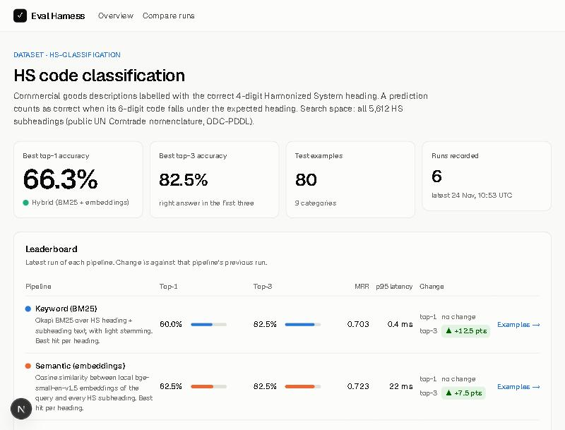

# Eval Harness

**Measure search and AI pipelines against a labelled test set, track quality over time, and stop regressions in CI.**

Most AI features ship on "it looked fine when I tried three queries". This project replaces that with numbers. You give it a test set of inputs with known correct answers and one or more pipelines (a keyword search, an embedding search, an LLM…). It runs each pipeline on every example, scores the results, saves each run as a JSON file, and shows everything on a dashboard: which pipeline wins, in which categories, what changed since the last run, and which examples broke.

The bundled demo answers a real question from a freight app I built (NexusTrade): *given a goods description, which Harmonized System (HS) customs code is it?*



## Results on the HS demo

80 hand-labelled commercial descriptions across 9 categories, searched against all 5,612 HS subheadings. A suggestion is correct when it falls under the right 4-digit heading.

| Pipeline | Top-1 | Top-3 | MRR | p95 latency |
|---|---|---|---|---|
| Keyword (BM25) | 60.0% | 82.5% | 0.703 | 0.4 ms |
| Semantic (local `bge-small-en-v1.5` embeddings) | 62.5% | 82.5% | 0.723 | 23 ms |
| **Hybrid (BM25 + embeddings, reciprocal rank fusion)** | **66.3%** | **82.5%** | **0.755** | 24 ms |

**What the harness showed**

- **Hybrid wins at top-1**, but the gap is small. With 80 examples, one example is 1.25 points, and the 95% confidence interval on a ~65% score is about ±10 points. The ranking *suggests* hybrid is better; it doesn't prove it. The honest next step is a bigger test set, not more tuning.
- **Diverse suggestions lifted top-3 by up to 12.5 points.** The run view showed that a pipeline's five suggestions were often near-duplicates from one heading ("cast iron fittings", "cast iron tubes", …). Keeping only the best hit per heading left top-1 unchanged, as expected, and raised top-3 from 70% → 82.5% (keyword), 75% → 82.5% (semantic) and 80% → 82.5% (hybrid). The compare page shows exactly which examples moved.
- **Everyday wording is the weak spot.** On the `jargon` category ("power banks", "hoodies", "camera drones") keyword search scores 0% and the best pipeline only 29%. The official HS wording ("accumulators, lithium-ion", "unmanned aircraft") never uses those words. 18 examples defeat every pipeline. They're listed on the dashboard as the to-do list.
- **Semantic is not uniformly better.** It wins on textiles and metals but loses to keyword on food and chemicals, where exact product names ("urea", "Portland cement") are strong signals. Hence the hybrid.

## What it does

| | |
|---|---|
| **CLI** | `npm run eval` runs every pipeline, prints a summary and saves `runs/<id>.json`. It also lists which examples were fixed or broke since the last run. |
| **Quality gate** | `npm run eval:check` re-runs everything and exits 1 if any pipeline's top-1 accuracy drops more than 2 points below its latest committed run. It runs in GitHub Actions on every PR. |
| **Overview** | Leaderboard with top-1/top-3/MRR/latency and change since the previous run, an accuracy-by-category heatmap, a quality-over-time chart, and the list of examples no pipeline solves. |
| **Run view** | Every example with its prediction, rank and latency. Filter to failures, by category or by text, and expand a row to see all five suggestions. |
| **Compare** | Pick any two runs (two pipelines, or before/after a change). It shows metric deltas and the examples that were fixed, regressed or stayed wrong. |

## Run it

```bash
npm install
npm run eval        # first run downloads a ~35 MB model and embeds the HS corpus (~3 min on a laptop CPU), then it's cached
npm run dev         # dashboard at http://localhost:3000
```

No API keys are needed. Embeddings run locally with [transformers.js](https://github.com/huggingface/transformers.js).

Other commands: `npm run eval -- --list`, `npm run eval -- --pipeline hs-hybrid`, `npm test`, `npm run typecheck`.

## Evaluate your own system

**1. A dataset**: `evals/datasets/<id>/dataset.json`

```json
{
  "id": "my-dataset",
  "name": "Support ticket routing",
  "description": "…",
  "matcher": { "type": "exact" },
  "examples": [{ "id": "t-001", "input": "My card was charged twice", "expected": "billing", "tags": ["payments"] }]
}
```

`matcher` decides what counts as correct: `exact`, or `prefix` with a length (the HS demo uses `{ "type": "prefix", "length": 4 }`).

**2. A pipeline**: implement the `Pipeline` interface and add it to `src/pipelines/registry.ts` (plus a display entry in `catalog.ts`):

```ts
export const myPipeline: Pipeline = {
  id: 'my-llm-router',
  name: 'LLM router',
  description: 'Claude classifies the ticket into a queue.',
  datasets: ['my-dataset'],
  setup: async () => { /* load models, build indexes — not timed */ },
  predict: async (input) => [{ label: 'billing', score: 0.92 }], // ranked best-first
}
```

The runner, metrics, run history, dashboard and CI gate need no further changes.

## How it's built

- **Next.js 16** (App Router, Cache Components) + **Tailwind 4**. Every page is pre-rendered at build time from the committed run files, so the dashboard is a static site that deploys anywhere.
- **Runs are plain JSON in git.** History travels with the code, diffs show up in PRs, and there's no database to run. Each run records the commit (with `-dirty` if the code had uncommitted changes) and a hash of the test set, so runs on different test sets are never compared silently.
- **Metrics**: top-1/3/5 accuracy, mean reciprocal rank, mean and p95 latency (nearest-rank), all broken down by tag. Examples run one at a time so latency isn't distorted by contention.
- **Search**: a dependency-free Okapi BM25 with light stemming, `bge-small-en-v1.5` (quantised, 384-dim) for embeddings with an on-disk vector cache, and reciprocal rank fusion (k = 60) for the hybrid.
- **Charts** are hand-written SVG with hover tooltips, colour-blind-checked series colours, and separate light and dark palettes.
- **Tests**: Vitest covers metrics, ranking, run diffing, BM25, fusion and heading de-duplication.

```
evals/datasets/hs-classification/   dataset.json (80 labelled examples) + corpus.json (5,612 HS codes)
runs/                               one JSON file per run, committed
scripts/eval.ts                     CLI and CI quality gate
src/lib/eval/                       types, metrics, runner, run storage, run diffing
src/pipelines/                      BM25, embeddings, HS pipelines, registry
src/app/                            dashboard: overview, /runs/[id], /compare
```

## Limitations and next steps

- **Small test set.** 80 examples is enough to find failure patterns but too few to separate pipelines that are within a few points of each other. Next: grow it to 300+ and show bootstrap confidence intervals on every metric.
- **Tuning against the test set overfits it.** Any parameter chosen by looking at these 80 results needs a held-out split to confirm it.
- **An LLM pipeline.** A re-ranker that reads the top 10 suggestions and picks one should help most on the `jargon` category.
- Latency is measured on whatever machine runs the eval, so compare it only within one machine.

## Data

HS nomenclature from [datasets/harmonized-system](https://github.com/datasets/harmonized-system) (UN Comtrade, ODC-PDDL-1.0, public domain). Test descriptions and labels were written for this project.
